# Daily Fish

A new procedurally generated fish every day, or a bunch of flowers, drawn on a [Seeed Studio XIAO 7.5" ePaper Panel](https://www.seeedstudio.com/XIAO-7-5-ePaper-Panel-p-6416.html).

The picture is generated on the panel itself. There is no server, no companion app and no clock: every 24 hours the XIAO ESP32-C3 inside the panel wakes up, grows a new fish or flowers, draws them, and goes back to deep sleep.

Each one gets a pseudo-Latin species name, shown under it.

## In real life

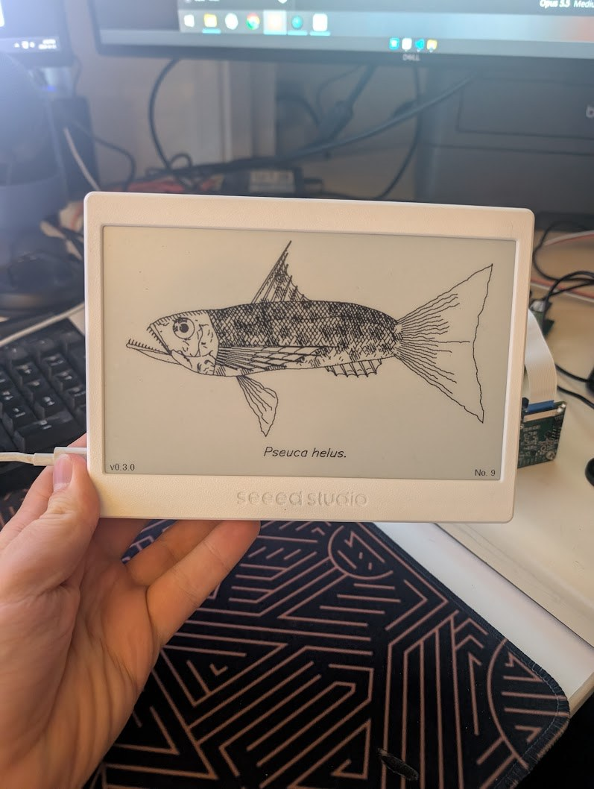

## Examples

These are the 800x480 images the panel draws, rendered by the desktop preview from the same code.

### Fish

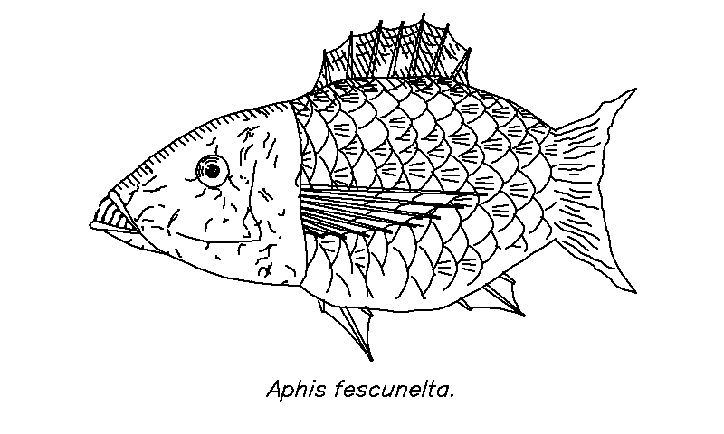

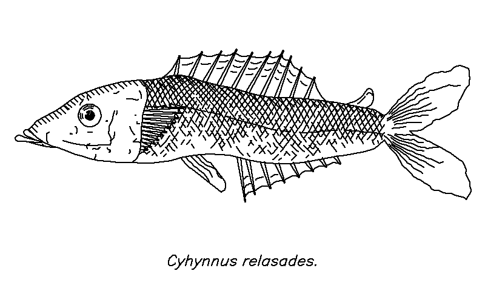

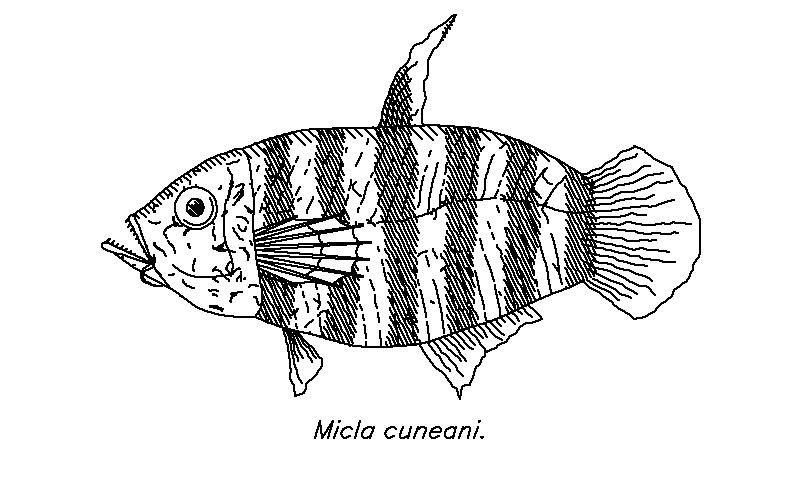

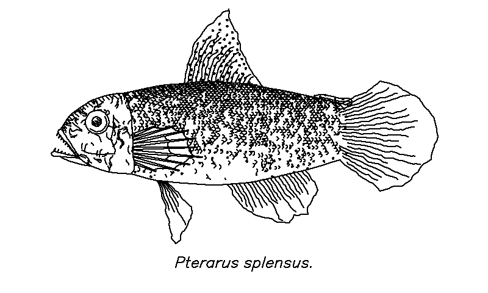

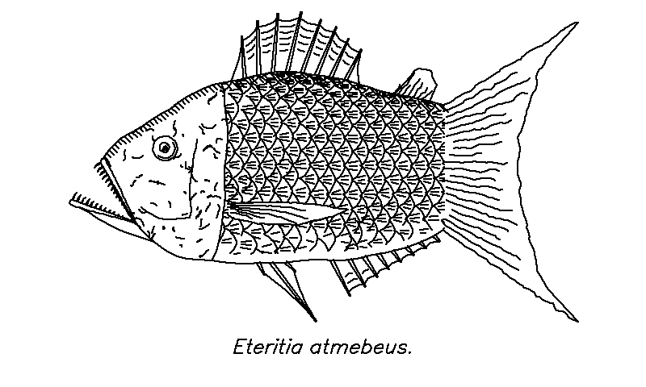

### Flowers

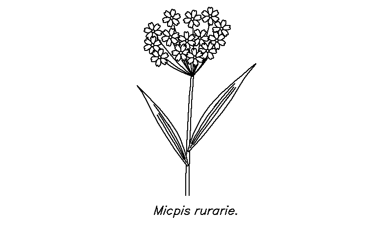

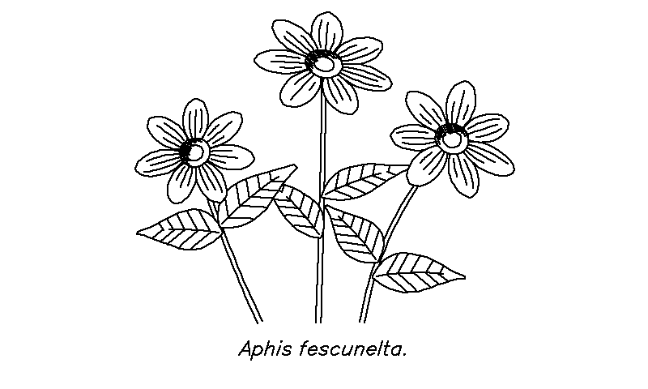

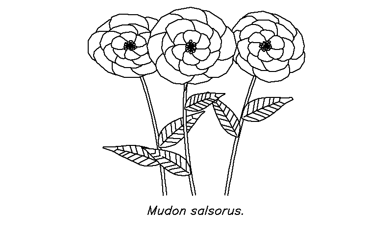

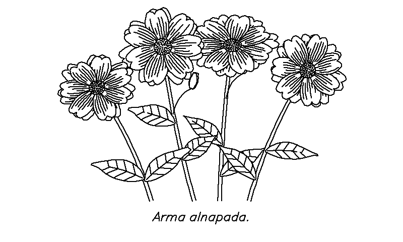

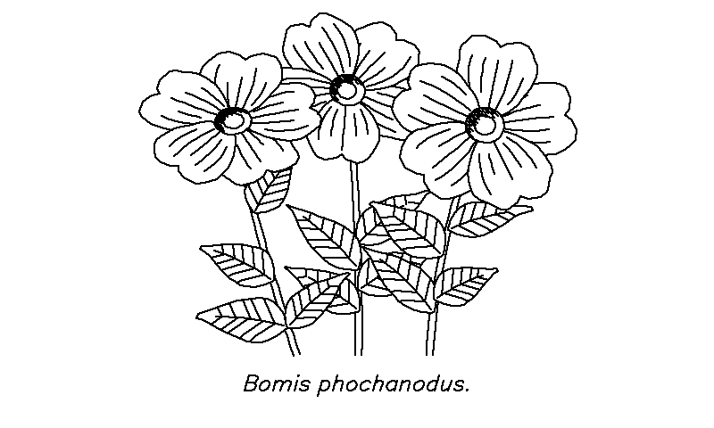

## Inspiration

This project is inspired by, and built on, [fishdraw](https://github.com/LingDong-/fishdraw) by Lingdong Huang: a single JavaScript file that generates all sorts of weird fish as plotter-style line drawings. Every fish here is a fishdraw fish. This repository ports that generator from JavaScript to C++ and restructures it to fit in the ESP32-C3's 400 KB of RAM, so it can run on the panel.

The flowers are not from fishdraw, which has none. They are a new generator written for this project in the same style, built on fishdraw's noise, clipping and hatching.

## Using it

- **A new picture** appears every 24 hours, of the same kind as the last: fish stay fish, flowers stay flowers.
- **Press Reset** (behind the stand) to switch between fish and flowers. It draws a new one straight away. Press it twice for a new picture of the same kind. The 24 hours then count from the press, so pressing Reset at the time of day you want the picture to change sets the schedule.
- **Picture number.** The panel counts every picture it has generated and keeps the count, and whether it is on fish or flowers, in flash, where they survive resets, a flat battery and firmware updates. The count picks the next picture, and is shown as "No. 42" in the bottom right corner.
- **Be patient with fish.** A fish takes 5 to 30 seconds to appear after a press. A small "Drawing a fish ..." box appears in the middle of the screen within a couple of seconds to show the press was noticed. Pressing Reset again while it is working starts the same picture again; it does not switch.
- **The Boot button** is not used. It cannot wake the panel from deep sleep; on this chip only Reset can.

## Updates

The panel can update its own firmware. After drawing each fish it joins Wi-Fi, asks GitHub for this repository's latest release, and installs it if it is newer than what it is running. It then restarts and draws a fresh fish with the new firmware. The version in use is shown in the bottom left corner.

This is off until the panel has Wi-Fi settings (2.4 GHz networks only). Two ways to give them:

- **Building from source:** copy `include/secrets.example.h` to `include/secrets.h`, fill it in, and upload. The firmware saves the settings to the panel's flash the first time it runs.
- **Over USB serial**, for a panel flashed from a release. Press Reset with the panel plugged into a computer, wait for the fish, and within the next 60 seconds send these two lines from any serial terminal at 115200 baud:

  ```
  ssid your-network-name
  pass your-network-password
  ```

The settings are kept in flash, apart from the firmware, so an update does not lose them. Sending `ota` checks for an update straight away.

How it stays safe:

- The connection to GitHub is verified against the root certificates built into the firmware, so the panel only installs what this repository published.
- A new firmware is on trial until it has drawn a fish. If it resets before that, the bootloader goes back to the previous version.
- It only ever moves to a higher version number, and a failed check or download just leaves things as they are until the next day.

Set `OTA_ENABLED` to 0 in `include/config.h` to build a firmware that never uses Wi-Fi.

## Installing

### From a release

Each [release](https://github.com/funvill/daily-fish/releases) has two files:

| File | Use |
|---|---|
| `daily-fish-vX.Y.Z-full.bin` | A panel's first flash. Write it at address `0x0`. This also resets the fish count |
| `daily-fish-vX.Y.Z.bin` | Updating a panel that already runs Daily Fish. Write it at `0x10000`. The fish count is kept |

With [esptool](https://docs.espressif.com/projects/esptool/) installed, and the panel in its bootloader (hold **Boot**, tap **Reset**, release **Boot**):

```bash
esptool --chip esp32c3 write_flash 0x0 daily-fish-v0.1.0-full.bin
```

Then tap Reset.

### From source

With [PlatformIO](https://platformio.org/):

```bash
pio run -e panel -t upload
```

### Uploading again later

In deep sleep the panel's USB port switches off, so the computer cannot see it. Three ways around that:

- Press **Reset** while the panel is plugged into the computer. It draws a new fish, then stays awake for 60 seconds before sleeping. Upload during that minute.
- Force the bootloader: hold **Boot**, tap **Reset**, release **Boot**, then upload.
- If you cannot reach the buttons, `python tools/bench/catch_bootloader.py COM8` waits for the panel's next wake and puts it in the bootloader from the computer.

## Settings

All in `include/config.h`:

| Setting | Default | What it does |
|---|---|---|
| `REFRESH_INTERVAL_S` | 24 hours | Time between pictures |
| `SWITCH_ON_RESET` | 1 | Reset switches between fish and flowers. With 0 it just draws a new one |
| `LINE_THICKNESS` | 2 | Line width in pixels. 1 is the hairline of the original drawings |
| `LOADING_NOTICE` | 1 | Show the "Drawing ..." box after a press of Reset |
| `SHOW_FISH_NUMBER` | 1 | Show "No. 42" in the bottom right corner |
| `SHOW_VERSION` | 1 | Show the firmware version in the bottom left corner |
| `OTA_ENABLED` | 1 | Look for a newer release after each fish, once Wi-Fi settings are saved |
| `USB_UPLOAD_WINDOW_S` | 60 | Seconds to stay awake after drawing when a computer is attached |
| `EPD_DRIVER_CLASS` | `GxEPD2_750_T7` | Display driver |

## Good to know

- **Which fish.** The panel's hardware address and the fish count seed a name generator, and the name seeds the fish. Two panels show different fish. `node fishdraw.js --seed "<name>"` with the original program draws the same fish for the same name.
- **Timekeeping.** The sleep timer is good to a few minutes a day, so the time the fish changes drifts slowly.
- **Time taken.** Generating a fish takes 5 to 30 seconds on the ESP32-C3, which has no floating point unit; flowers are quicker. The display refresh takes about 4 seconds.

## Releases

Pushing a version tag builds the firmware on GitHub and publishes it as a release:

```bash
git tag v0.2.0
```

```bash
git push origin v0.2.0
```

The workflow is `.github/workflows/release.yml`. The tag becomes the firmware's version, which it prints on the serial port when it starts.

## Working on it

### Desktop preview

The generator in `lib/fishdraw` has no Arduino dependencies, so the page can be rendered on a computer:

```bash
g++ -O2 -std=c++17 -Ilib/fishdraw -Isrc -Iinclude tools/preview/preview.cpp lib/fishdraw/fishdraw.cpp lib/fishdraw/flowerdraw.cpp -o build/preview
```

```bash
build/preview --name "Cterirus nigtus" build/fish.pbm
```

Add `--flower` before the other options for flowers. `build/preview --stress 3000` generates 3,000 fish (or, with `--flower` first, flowers) and reports the worst memory use and any failures. `tools/preview/sheet.py` renders several at once into a contact sheet.

`tools/preview/compare.py` renders the same names with the original `fishdraw.js` and with the port, one above the other, to check the port by eye.

### Bench firmware

`pio run -e bench -t upload` installs a version that never sleeps and takes commands over serial. `tools/bench/capture.py` sends a command and saves the frame the panel drew as a PNG:

```bash
python tools/bench/capture.py COM8 next build/panel.png
```

Commands are `next` (draw the next picture, as a daily wake would), `switch` (change between fish and flowers, as Reset would), `name <species name>` for a fish, `flower <species name>` for flowers, and the `ssid`, `pass` and `ota` commands described under Updates.

### Layout of the code

| Path | What is in it |
|---|---|
| `lib/fishdraw/fishdraw.cpp` | The fish generator and single-stroke text. Portable C++ |
| `lib/fishdraw/flowerdraw.cpp` | The flower generator |
| `lib/fishdraw/fishdraw_core.inc` | What both share: noise, clipping, polygon union, hatching |
| `lib/fishdraw/fishdraw_tables.inc` | Name syllables and glyphs, extracted from the original by `tools/gentables.js` |
| `src/layout.h` | Where the picture, the name and the number go on the 800x480 screen |
| `src/main.cpp` | The counter, fish or flowers, drawing, the display, and deep sleep |
| `src/ota.cpp` | Wi-Fi settings and updates from GitHub releases |
| `include/config.h` | Settings |

### How the port fits in memory

The original builds every line of the fish as JavaScript arrays, up to about 25,000 points, then scales the lot to the page. On the panel:

- Finished lines are packed as 16-bit coordinates into one 90 KB block.
- The scale textures, which are most of the points, are generated one scale at a time straight into that block.
- Cutting away the parts hidden behind fins and the head is done in place inside the block.
- Pattern shading, which never changes the outline, is drawn as it is generated and never stored.

Random numbers are drawn in exactly the original order, which is what keeps the fish identical to the original's.

## Credits

Inspired by [fishdraw](https://github.com/LingDong-/fishdraw). Fish generation is a port of fishdraw, copyright (c) 2021 Lingdong Huang, MIT License. See `LICENSE-fishdraw.txt`.

The display is driven by [GxEPD2](https://github.com/ZinggJM/GxEPD2) by Jean-Marc Zingg.
